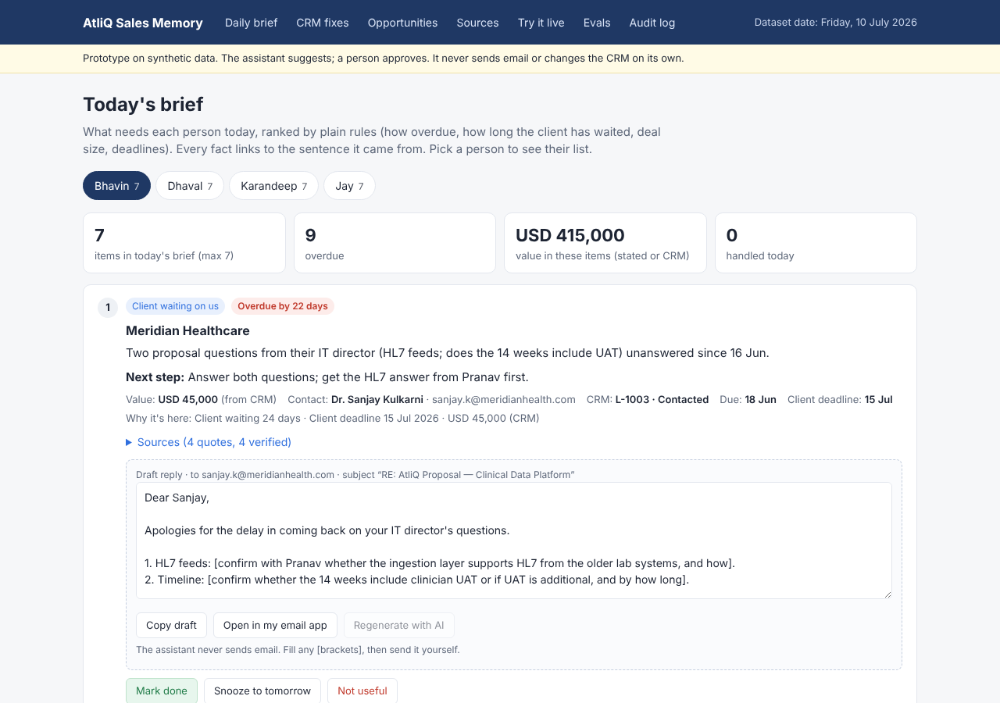

# AtliQ Sales Memory Assistant (prototype)

A working prototype of the assistant described in the AtliQ AI PRD. It reads AtliQ's sales emails, meeting notes and CRM export. It then gives each founder-seller a short daily brief: who is waiting on us, what we promised, which deadlines are coming, and which deals have gone quiet. Every fact links back to the exact sentence it came from, and nothing is sent or changed without a person approving it.

Dataset date: **Friday, 10 July 2026** (the "today" of the provided data).

## What you can do in it

| Page | What it shows |
|---|---|
| **Daily brief** | Up to 7 ranked items per person (Bhavin, Dhaval, Karandeep, Jay). Each item has a reason, a due date with the rule behind it, its source quotes and a draft reply. You can mark an item done, snooze it, or say it was not useful. |
| **CRM fixes** | Leads missing from the CRM, duplicate records, stale fields and missing follow-up dates. Approve or reject each change, then export the corrected CRM as CSV. |
| **Opportunities** | Cross-sell signals from happy clients, plus lost or quiet deals that have a reason to re-open. |
| **Sources** | All 50 dataset files, so any quote can be checked in context. |
| **Try it live** | Paste a new email and Claude extracts items from it, each checked against your text. This is how the dataset can be extended. It needs an API key. |
| **Evals** | 12 known answers hidden in the dataset, checked every time the page loads. All 12 pass. |
| **Audit log** | Who approved, rejected, copied or undid what, and when. |

## Run it on your computer

You need Node.js 20 or newer.

```bash
npm install
npm run dev          # open http://localhost:3000
```

That's it. The whole app works without an API key, because it runs on a saved AI extraction (see "How it works").

To switch on the live AI features (**Try it live** and **Regenerate with AI**), copy `.env.example` to `.env.local` and add your key:

```bash
ANTHROPIC_API_KEY=sk-ant-...
```

For a production build, run `npm run build` and then `npm start`.

## Deploy to Vercel (free tier)

**Option A: from GitHub (easiest)**
1. Push this folder to a new GitHub repository.
2. Go to vercel.com, choose **Add New → Project**, and import the repository. Vercel detects Next.js on its own, so keep the default settings.
3. Optional: under **Settings → Environment Variables**, add `ANTHROPIC_API_KEY`, then redeploy.
4. Vercel gives you a URL such as `atliq-sales-memory.vercel.app`.

**Option B: from your terminal**
```bash
npx vercel           # log in, accept the defaults
npx vercel --prod    # publish
```



## How it works

Think of it as two steps: **AI reads, rules decide.**

1. **AI reads.** Claude reads each email or note and lists what's in it: a client question, a promise, a deadline, a new lead, a value. Each one comes with the exact sentence it was based on.
   - The saved result is in `data/extracted.json`: 44 items, 19 CRM updates and 5 new leads, made with the prompts in `lib/prompts.mjs`.
   - `npm run extract` re-runs it with Claude Haiku 5.5. This needs a key, and the output goes to `data/extracted.ai.json` for you to review.
2. **A checker verifies.** `lib/verify.ts` looks for every quote word-for-word in its source file. If no quote for an item is found, the item is held back and never shown. *Example: if the AI claimed "Meridian has a 500k budget" and no file says that, the item is dropped.*
3. **Rules decide.** Plain code in `lib/brief.ts` sets due dates and the order of the brief, so the same data always gives the same brief.
   - A client question gets a reply due within 2 working days.
   - A promise we made gets 5 working days, unless a date was stated.
   - Priority goes up with days overdue, days the client has waited, nearby client deadlines and deal value.
   - Each person sees at most 7 items.
4. **People approve.** Drafts can only be copied or opened in your own email app, and CRM changes apply only after someone clicks Approve. Every action goes into the audit log.

| Part | Model | Why |
|---|---|---|
| Extraction (`/api/extract`, `npm run extract`) | Claude Haiku 5.5, low effort | High volume and simple reading, so the cheapest model is enough |
| Reply drafts (`/api/draft`) | Claude Sonnet 5.5, medium effort | Low volume and client-facing, so quality matters more |

Both calls use structured output (a fixed JSON shape) and prompt caching for the system prompt.

## Guardrails (from Step 2) and where they live

| Guardrail | How the prototype enforces it |
|---|---|
| No fact without a source | Quote verifier; unverified items are held back (`lib/verify.ts`, `lib/brief.ts`) |
| Never guess numbers | Values come from a quoted source or the CRM, otherwise they show "Not stated"; drafts use `[placeholders]` for unknowns |
| Never send email | There is no send endpoint, only Copy and Open in my email app |
| Never change the CRM silently | Every change needs an Approve click, can be undone, and is logged |
| Keep the brief short | At most 7 items per person; the rest sit under "See all" |
| Send only what's needed to the AI | Try it live sends the pasted text plus only the CRM rows that match its email domain, up to 20,000 characters |
| Evals catch regressions | `/evals` re-checks 12 known answers on every load |

## Project layout

```
app/                 pages (brief, crm, opportunities, sources, try, evals, audit) and API routes
components/          brief cards, CRM approval view
lib/
  prompts.mjs        the AI prompts and output schemas
  ai.ts              live Claude calls (only used when a key is set)
  verify.ts          the quote checker
  brief.ts           due-date rules, ranking, CRM change list
  crm.ts             lead matching and duplicate detection
  evals.ts           the 12 checks
data/
  raw/               the 50 provided emails and notes
  crm_export.csv     the provided CRM export
  extracted.json     saved AI extraction (what the app shows)
scripts/
  build-data.mjs     turns raw files into JSON (runs automatically before dev/build)
  extract.mjs        re-runs the AI extraction (needs a key)
```

## Honest limits of this prototype

- The saved extraction was produced by Claude at build time using the same prompts, so the hosted app does not need a key. Live extraction and drafting only run when `ANTHROPIC_API_KEY` is set.
- Decisions and the audit log are stored in your browser (localStorage). A real version would keep them on a server, with sign-in.
- The data is synthetic and frozen at 10 July 2026; there is no live Gmail or CRM connection.
